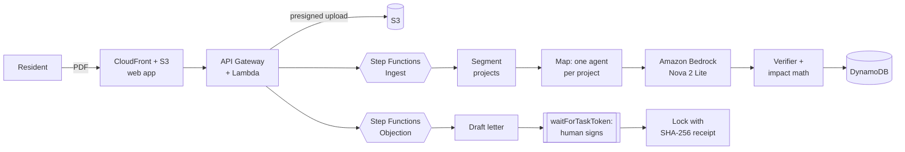

# vakeel · वकील

[](https://github.com/adhavan18/vakeel/actions/workflows/ci.yml)
[](https://d4i9n8m04ddaa.cloudfront.net)
[](LICENSE)

reads india's environmental clearance filings for the people who live next to the project, checks every number against the page it came from, and helps them object before it's approved.

[live app](https://d4i9n8m04ddaa.cloudfront.net) · [demo (2:58)](https://www.youtube.com/watch?v=IDNKushA0cg) · [build log](#build-log)


## why

coal power in india is linked to [up to 115,000 early deaths a year](https://www.scientificamerican.com/article/coal-fired-power-in-india-may-cause-more-than-100000-premature-deaths-annually/). the environmental clearance is the last point anyone can say no to a new plant, mine or dam. the filings are public on [parivesh](https://parivesh.nic.in), and hundreds of pages long.

in the expert appraisal committee (thermal) minutes of 20 june 2025, page 18 lets a 1,320 mw coal expansion at korba, drawing 104,110 m³ a day from the hasdeo river, skip its public hearing under [s.o. 1247(e)](https://dste.py.gov.in/SEIAA/pdf/Notifications/N38.pdf). page 25 recommends it. vakeel read the whole thing and found both lines in 52 seconds.

## what it does

- reads in parallel: step functions runs one amazon bedrock (nova 2 lite) agent per project
- proves every claim: each number needs a word-for-word quote and a page, code checks it against the pdf, and rejected claims are shown
- speaks plainly: english, hindi and the state's language, with no number the verifier didn't pass
- does the math in code: co₂, climate cost, water and coal from published, cited factors
- links every figure to its page: tap a ✓ to see the quote on the real pdf
- needs a human to sign: step functions waits on a task token until the resident signs the objection

| | |
|---|---|
|  |  |
|  |  |

## on real filings

| filing | pages | read in | found |
|---|---|---|---|
| eac thermal, 20 jun 2025 | 246 | 52 s | korba 1,320 mw recommended with its public hearing skipped; jindal deferred over 31 non-compliances |
| eac coal mining, 8 dec 2025 | 250 | 45 s | karo mine *ran at 15 mtpa while allowed 1.5*, recommended; ultratech clears 652.9 ha of forest |
| eac thermal, 30 apr 2026 | 236 | 39 s | jhabua power dumping ash without approval, returned |

732 pages, 17 projects, 219 claims kept, 65 thrown out.

## how it's built



serverless in `ap-southeast-2`, deployed with cloudformation (sam). a cloudwatch dashboard tracks filings read, bedrock tokens, agent errors and signatures, with alarms on failed reads. guardrails: a daily bedrock cap in dynamodb, page and size limits, api throttling, one execution per document, and sha-256 dedupe. a full filing is about 200k tokens.

## run it

python 3.12, node 20+, and aws credentials with bedrock access for the analysis step.

```bash
pip install -r requirements.txt -r requirements-dev.txt
python -m pytest -q tests                              # verifier, impact math, guards, segmenter
python scripts/analyze_local.py path/to/filing.pdf     # full pipeline against bedrock
cd web && npm install && npm run dev                   # offline preview: http://localhost:5173/?mock
bash scripts/deploy.sh                                 # stack + web app to s3/cloudfront
```

```
backend/   pipeline (pdf, extract, verify, impact, editor, draft) and lambda handlers
infra/     cloudformation + sam template
web/       react, vite, tailwind, leaflet
tests/     unit tests for the deterministic core
video/     launch film (remotion), voiceover, score, encoder
docs/      build log and hackathon notes
```

## limits

- vakeel never files anything itself. residents send the signed letter, so it carries their name.
- climate costs are estimates. v1 reads text pdfs; scanned ones need an amazon textract step.

related: [open permit](https://github.com/LarytheLord/Automated-Factory-Farm-Objection-Generator) tracks permit listings and writes law-citing letters. vakeel reads the filing itself and proves each fact against its page.

## build log

six posts on aws builder center:

1. [we built an ai that isn't allowed to make anything up](https://builder.aws.com/content/3KXmQEU3NpHdPcboqyu278IJgu2/we-built-an-ai-that-isnt-allowed-to-make-anything-up-then-pointed-it-at-indias-coal-plant-approvals)
2. [how we fact-check an llm against a 246-page pdf](https://builder.aws.com/content/3KXpWljfUj9Vs5qcw1zUJHOqEUI/how-we-fact-check-an-llm-against-a-246-page-pdf)
3. [a legal signature as a step functions waitfortasktoken](https://builder.aws.com/content/3KXqBM7zFjJKBY37TgHgkPUSb5Y/a-legal-signature-as-a-step-functions-waitfortasktoken)
4. [fixing "explicit deny in a service control policy" on aws](https://builder.aws.com/content/3KXqVfIYB2dJkiTDARJRMtPn8na/fixing-explicit-deny-in-a-service-control-policy-on-aws)
5. [parallel bedrock agents on a $100 aws budget](https://builder.aws.com/content/3KXyQ8AUuYqu5a9JYvaQDjdAPbq/parallel-bedrock-agents-on-a-dollar100-aws-budget)
6. [we made our launch film in code with amazon polly](https://builder.aws.com/content/3KXylOcV0ArLzLgt97NlEHsxygS/we-made-our-launch-film-in-code-with-amazon-polly)

built by tamil adhavan s k for environmental hacks 2026 (wemakedevs × aws, bharat builds tour). source documents are public records from parivesh, ministry of environment, forest and climate change. mit licensed.
