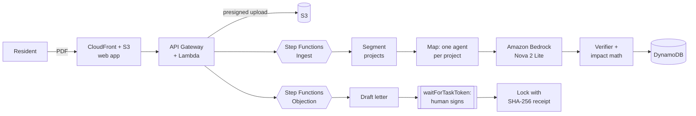

# Vakeel · वकील

[](https://github.com/adhavan18/vakeel/actions/workflows/ci.yml)
[](https://d4i9n8m04ddaa.cloudfront.net)
[](LICENSE)

Vakeel reads India's environmental clearance filings for the people who live next to the project. It turns a 246-page committee document into plain-language facts, in English, Hindi or the state's language. Every number is verified against the page it came from. Then Vakeel helps residents file a formal objection before the project is approved.


## Why

Every coal plant, mine and dam in India needs an environmental clearance. The paperwork is public on [PARIVESH](https://parivesh.nic.in), and the law gives affected people a voice, but nobody uses it, because nobody can read it.

In the Expert Appraisal Committee (Thermal) minutes of 20 June 2025, **page 18** records that a 1,320 MW coal expansion at Korba, 2.2 km from a reserved forest, was *exempted from its public hearing*. **Page 25** records that the committee *recommended* it. Vakeel finds that in under a minute.

## What it does

- **Reads whole filings in parallel.** AWS Step Functions splits the document into projects and runs one Amazon Bedrock (Nova 2 Lite) agent per project. A 246-page filing takes under a minute.
- **Proves every claim.** The model must return a word-for-word quote and a page for every number. Code checks each quote against the PDF and drops anything it can't find. Dropped claims are listed openly under *What Vakeel refused to tell you*.
- **Speaks plainly, in the reader's language.** Headlines in English, Hindi and the state's language. Generated text can't introduce a number that isn't in the verified data.
- **Keeps the money math out of the model.** CO₂, climate cost (₹ crore a year), water use (in people's daily water) and coal trains are computed in code from published factors, and every factor is cited.
- **Links every figure to its source.** Tap any ✓ to open the exact page with the quote highlighted, or the government's original PDF.
- **Drafts objections a human must sign.** The grounds quote the committee's own record with page numbers. Nothing is filed until the resident reads the letter and types an exact sentence. Step Functions waits on a task token, and the signed letter is locked with a SHA-256 receipt.

| | |
|---|---|
|  |  |
|  |  |

## On real filings

| Filing | Pages | Read in | Findings |
|---|---|---|---|
| EAC Thermal, 20 Jun 2025 | 246 | < 1 min | Korba (Adani Power) 1,320 MW recommended with the public hearing exempted; 104,110 m³/day from the Hasdeo River; Jindal deferred over 31 non-compliances |
| EAC Coal Mining, 8 Dec 2025 | 250 | 45 s | Central Coalfields' Karo mine *ran at 15 MTPA while allowed 1.5*, recommended; UltraTech clears 652.9 ha of forest |
| EAC Thermal, 30 Apr 2026 | 236 | 39 s | Jhabua Power dumping ash without approval, returned |

Across these: 732 pages, 17 projects, 224 claims verified and 75 rejected.

## Architecture



**AWS:** Bedrock, Step Functions, Lambda, API Gateway, DynamoDB, S3, CloudFront and Location Service, deployed with CloudFormation (SAM transform) in `ap-southeast-2`. The launch film is narrated with Amazon Polly.

**Cost guardrails:**
- an atomic daily Bedrock call cap in DynamoDB;
- page, size and project limits;
- API throttling;
- one execution per document;
- SHA-256 dedupe, so the same PDF is never paid for twice.

One full filing costs roughly 200k tokens.

## Quick start

Requirements: Python 3.12, Node 20+, and AWS credentials with Bedrock access (for the analysis step only).

```bash
pip install -r requirements.txt -r requirements-dev.txt
python -m pytest -q tests                       # verifier, impact math, guards, segmenter
python scripts/analyze_local.py path/to/filing.pdf   # run the full pipeline locally against Bedrock
```

Preview the web app offline on a real exported analysis:

```bash
cd web && npm install && npm run dev            # open http://localhost:5173/?mock
```

## Deploy

```bash
bash scripts/deploy.sh                          # CloudFormation stack + web app to S3/CloudFront
python scripts/upload.py <api-url> filing.pdf   # read a filing through the live API
```

## Project structure

```
backend/vakeel/     pipeline: pdf, extract, verify, impact, editor, draft, geo, store, llm
backend/handlers/   HTTP API and Step Functions task handlers
infra/template.yaml CloudFormation + SAM
web/                React, Vite, Tailwind, Motion, Leaflet
tests/              unit tests for the deterministic core
video/              launch film (Remotion), voiceover, score, encoder
docs/blog/          build log
```

## Related work

- **[Open Permit](https://github.com/LarytheLord/Automated-Factory-Farm-Objection-Generator)** monitors permit listings across eight countries, including PARIVESH. It uses Gemini to write objection letters that cite laws, from stakeholder personas. Vakeel works one layer deeper: it reads the *contents* of the filing itself (hundreds of pages of committee minutes or an EIA), verifies every fact against the page it came from, computes the impact in code, and explains it to residents in their language before any letter is drafted. The letter's grounds are the committee's own words, with page numbers.
- **CSE's citizen EIA toolkit** trains people to read clearance documents by hand. Vakeel automates the reading and keeps the evidence checkable.
- **[india-environmental-approvals](https://github.com/Vonter/india-environmental-approvals)** is an open dataset of PARIVESH applications, and a natural source for automatic filing discovery.

## Limits

- Vakeel never submits anything itself. Residents send the signed letter from their own email or by post, so it carries their identity.
- Climate-cost figures are estimates from the proposal's stated capacity and published factors, and are labelled as estimates.
- v1 reads text PDFs, which covers committee minutes and most EIA reports. Scanned filings will need an Amazon Textract step.

## Credits

Built for **Environmental Hacks 2026** (WeMakeDevs × AWS, Bharat Builds Tour) by Tamil Adhavan S K. Source documents are public records from PARIVESH, Ministry of Environment, Forest and Climate Change. MIT licensed.
