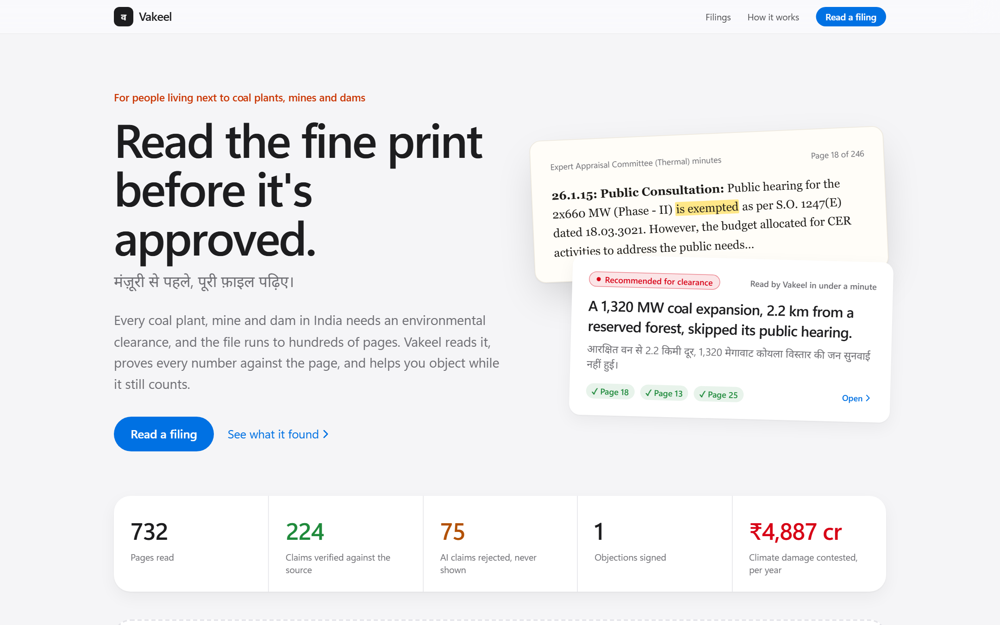
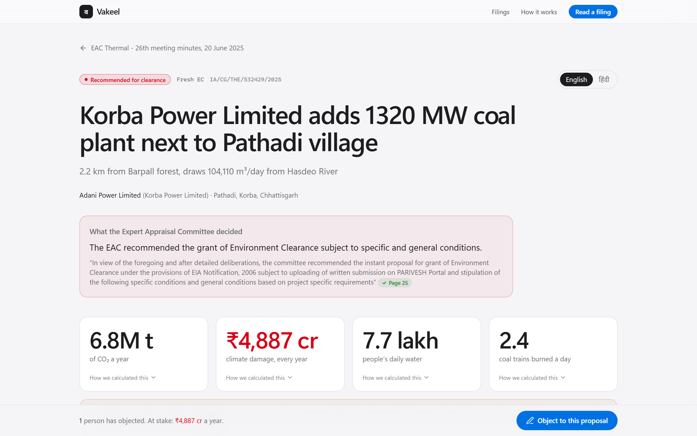
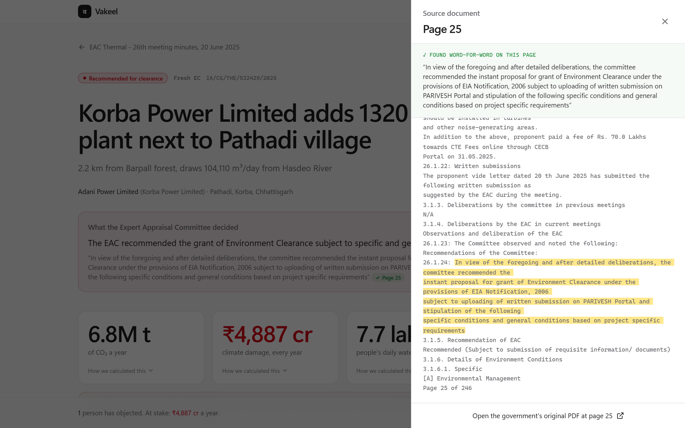
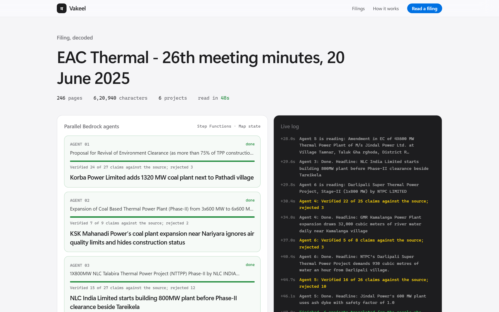
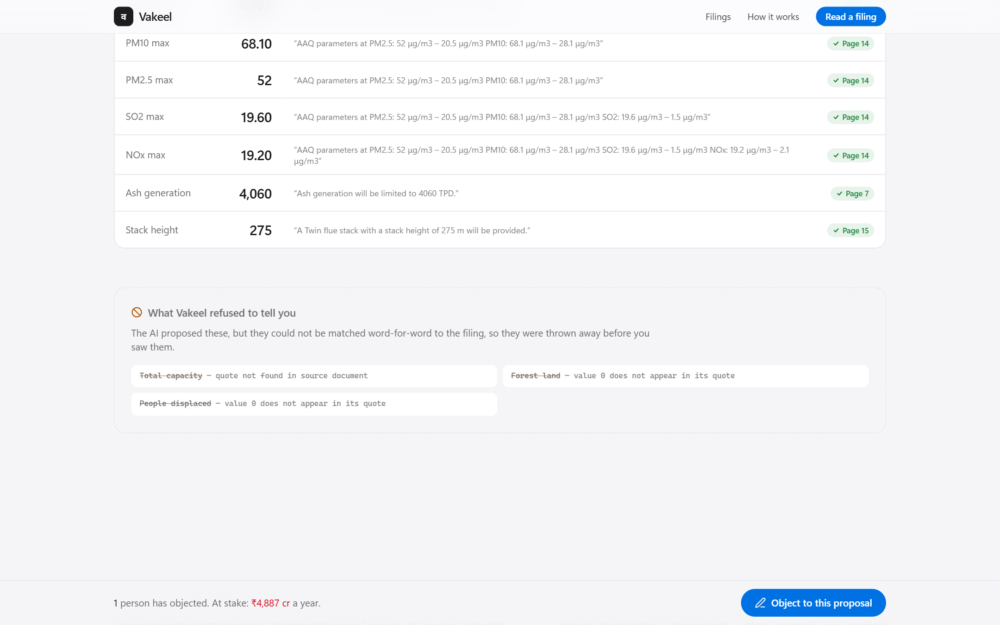
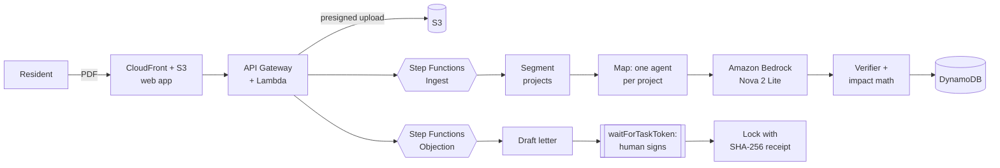

# Vakeel · वकील

[](https://github.com/adhavan18/vakeel/actions/workflows/ci.yml)
[](https://d4i9n8m04ddaa.cloudfront.net)
[](LICENSE)

Vakeel reads India's environmental clearance filings for the people who live next to the project, proves every number against the page it came from, and helps them object before the project is approved.

**[Live app](https://d4i9n8m04ddaa.cloudfront.net)** · **[Demo (2:58)](https://www.youtube.com/watch?v=IDNKushA0cg)** · **[Build log](#build-log)**



## Why

India's coal power is linked to [as many as 115,000 premature deaths a year](https://www.scientificamerican.com/article/coal-fired-power-in-india-may-cause-more-than-100000-premature-deaths-annually/). The environmental clearance is the last point where anyone can say no to a new plant, mine or dam, but the filings on [PARIVESH](https://parivesh.nic.in) run to hundreds of pages.

In the Expert Appraisal Committee (Thermal) minutes of 20 June 2025, **page 18** exempts a 1,320 MW coal expansion at Korba, drawing 104,110 m³ a day from the Hasdeo River, from its public hearing under [S.O. 1247(E)](https://dste.py.gov.in/SEIAA/pdf/Notifications/N38.pdf). **Page 25** recommends it. Vakeel read the whole filing and surfaced both lines in 52 seconds.

## What it does

- **Reads in parallel:** AWS Step Functions runs one Amazon Bedrock (Nova 2 Lite) agent per project.
- **Proves every claim:** each number needs a word-for-word quote and a page; code checks it against the PDF and lists what it rejected.
- **Speaks plainly:** headlines in English, Hindi and the state's language, with no number the verifier didn't pass.
- **Does the math in code:** CO₂, climate cost, water and coal from published, cited factors.
- **Links every figure to its page:** tap any ✓ to see the quote highlighted on the real PDF.
- **Needs a human to sign:** objections quote the committee's own record, and Step Functions waits on a task token until the resident signs.

| | |
|---|---|
|  |  |
|  |  |

## On real filings

| Filing | Pages | Read in | Findings |
|---|---|---|---|
| EAC Thermal, 20 Jun 2025 | 246 | 52 s | Korba 1,320 MW recommended with its public hearing exempted; Jindal deferred over 31 non-compliances |
| EAC Coal Mining, 8 Dec 2025 | 250 | 45 s | Karo mine *ran at 15 MTPA while allowed 1.5*, recommended; UltraTech clears 652.9 ha of forest |
| EAC Thermal, 30 Apr 2026 | 236 | 39 s | Jhabua Power dumping ash without approval, returned |

732 pages, 17 projects, 219 claims verified, 65 rejected.

## Architecture



Serverless in `ap-southeast-2`, deployed with CloudFormation (SAM). Guardrails: an atomic daily Bedrock cap in DynamoDB, page and size limits, API throttling, one execution per document, and SHA-256 dedupe. A full filing costs about 200k tokens.

## Run it

Python 3.12, Node 20+, and AWS credentials with Bedrock access for the analysis step.

```bash
pip install -r requirements.txt -r requirements-dev.txt
python -m pytest -q tests                              # verifier, impact math, guards, segmenter
python scripts/analyze_local.py path/to/filing.pdf     # full pipeline against Bedrock
cd web && npm install && npm run dev                   # offline preview: http://localhost:5173/?mock
bash scripts/deploy.sh                                 # stack + web app to S3/CloudFront
```

```
backend/   pipeline (pdf, extract, verify, impact, editor, draft) and Lambda handlers
infra/     CloudFormation + SAM template
web/       React, Vite, Tailwind, Leaflet
tests/     unit tests for the deterministic core
video/     launch film (Remotion), voiceover, score, encoder
docs/      build log and hackathon notes
```

## Limits

- Vakeel never files anything itself; residents send the signed letter so it carries their identity.
- Climate costs are labelled estimates. v1 reads text PDFs; scanned filings need an Amazon Textract step.

Related: [Open Permit](https://github.com/LarytheLord/Automated-Factory-Farm-Objection-Generator) tracks permit listings and writes law-citing letters; Vakeel reads the filing itself and proves each fact against its page.

## Build log

A six-part series on AWS Builder Center:

1. [We built an AI that isn't allowed to make anything up, then pointed it at India's coal plant approvals](https://builder.aws.com/content/3KXmQEU3NpHdPcboqyu278IJgu2/we-built-an-ai-that-isnt-allowed-to-make-anything-up-then-pointed-it-at-indias-coal-plant-approvals)
2. [How we fact-check an LLM against a 246-page PDF](https://builder.aws.com/content/3KXpWljfUj9Vs5qcw1zUJHOqEUI/how-we-fact-check-an-llm-against-a-246-page-pdf)
3. [A legal signature as a Step Functions waitForTaskToken](https://builder.aws.com/content/3KXqBM7zFjJKBY37TgHgkPUSb5Y/a-legal-signature-as-a-step-functions-waitfortasktoken)
4. [Fixing "explicit deny in a service control policy" on AWS](https://builder.aws.com/content/3KXqVfIYB2dJkiTDARJRMtPn8na/fixing-explicit-deny-in-a-service-control-policy-on-aws)
5. [Parallel Bedrock agents on a $100 AWS budget](https://builder.aws.com/content/3KXyQ8AUuYqu5a9JYvaQDjdAPbq/parallel-bedrock-agents-on-a-dollar100-aws-budget)
6. [We made our launch film in code with Amazon Polly](https://builder.aws.com/content/3KXylOcV0ArLzLgt97NlEHsxygS/we-made-our-launch-film-in-code-with-amazon-polly)

Built by Tamil Adhavan S K for Environmental Hacks 2026 (WeMakeDevs × AWS, Bharat Builds Tour). Source documents are public records from PARIVESH, Ministry of Environment, Forest and Climate Change. MIT licensed.
