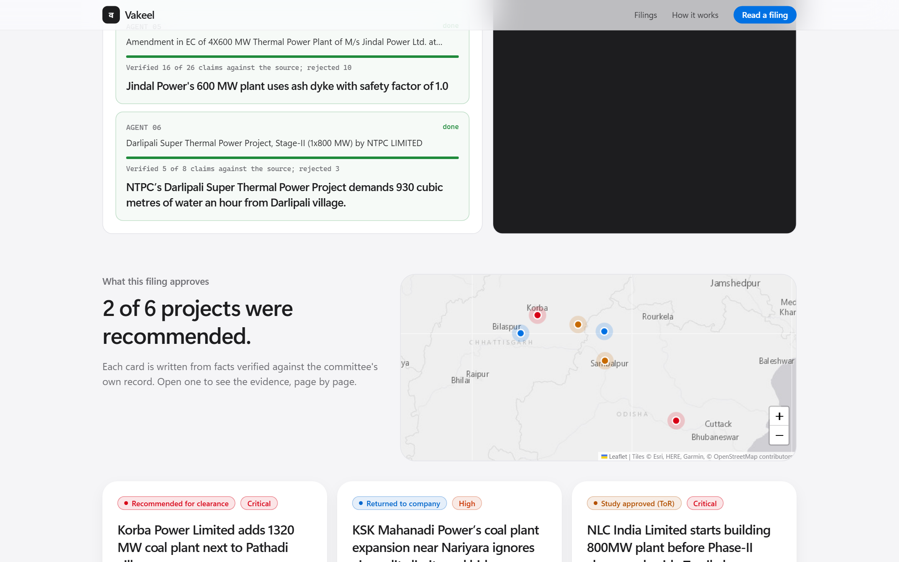

# A legal signature as a Step Functions state: human-in-the-loop with waitForTaskToken

*Part 3 of the Vakeel build log · Environmental Hacks 2026 · #BharatBuilds*

Vakeel helps residents object to coal plants and mines before they're cleared. It drafts a formal objection to India's Expert Appraisal Committee from the committee's own record. The one thing it must **never** do is send a legal document in someone's name on its own.

Here's how we made "a human must read and sign this first" a hard property of the system rather than a promise in a prompt.



## The state machine

```
Draft ──► AwaitSignature ──► File
  │       (waitForTaskToken,      │
  │        7-day timeout)         │
  └────────── Expire ◄────────────┘   (any failure or timeout)
```

```yaml
AwaitSignature:
  Type: Task
  Resource: arn:aws:states:::lambda:invoke.waitForTaskToken
  Parameters:
    FunctionName: !Ref AwaitSignatureFunction
    Payload:
      objectionId.$: $.objectionId
      taskToken.$: $$.Task.Token
  TimeoutSeconds: 604800
  Catch: [{ ErrorEquals: [States.ALL], Next: Expire }]
  Next: File
```

The `AwaitSignature` Lambda does one thing: it stores the task token on the objection record in DynamoDB and returns. The execution then **pauses for up to seven days**, costing nothing. If nobody signs, it times out into `Expire` and nothing is filed.

## Two checks before SendTaskSuccess

The signing endpoint is the only place that can resume the workflow, and it checks two independent things:

```python
if normalise(body["phrase"]) != normalise(obj["phrase"]):
    raise HttpError(400, f"Type exactly: {obj['phrase']}")
if body["letterHash"] != obj["letterHash"]:
    raise HttpError(409, "The letter changed since you read it.")
sfn.send_task_success(taskToken=obj["taskToken"], output='{"signed": true}')
```

1. **An exact phrase**, e.g. `I object to proposal IA/CG/THE/532429/2025`. Typing the proposal number is deliberate friction: you can't sign by accident, and you know which project you're objecting to.
2. **The SHA-256 of the letter the citizen actually read.** The browser sends back the hash it displayed. If the stored letter changed in any way between reading and signing, the signature is refused.

Only then does `File` run. It writes a receipt, `sha256(letterHash | name | signedAt)`, and increments the public counters.

## Why the model can't put words in the citizen's mouth

The letter is built mostly by code:
- **Grounds of objection** come from verified concerns. Each one quotes the committee's record with a page number, and every quote has already passed the verifier.
- **Climate figures** are computed in Python and labelled as estimates.
- **Bedrock writes only the opening paragraph and the requests**, and the drafting code throws those away if they contain any digit at all. A model can't invent a statistic it isn't allowed to write.

## Why not just a database flag?

We could have stored `status = awaiting_signature` and polled. Step Functions gave us more for less code:
- the pause, the timeout and the expiry path are declared, not hand-written;
- every objection has an execution history showing exactly when it was drafted, signed and filed, which is an audit trail for a legal document;
- execution names are unique (`obj-<id>`), so a double-click can't start two workflows.

The same pattern secured last round's winners (Beacon's voice-approved remediation, Suraksha's consent gates). For a civic tool it fits even better: the human isn't approving a deployment, they're putting their name to a legal objection.
