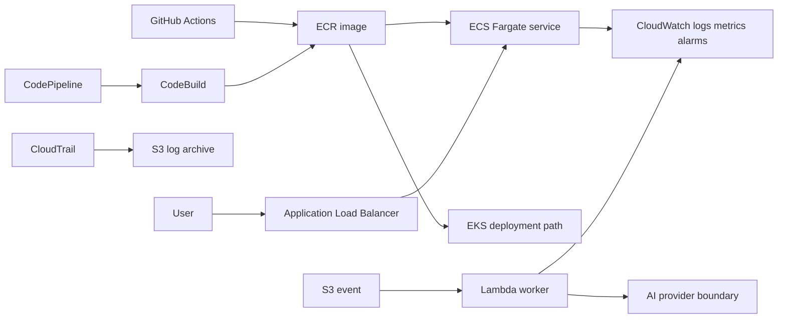

# Platform Engineering Lab

Production-oriented AWS reference platform for deploying a containerized AI API with two delivery paths:

- Terraform provisions the shared AWS foundation: VPC, ECR, ECS Fargate, ALB, CloudWatch, CloudTrail, and least-privilege IAM.
- CloudFormation/SAM provisions the event-driven Lambda worker and its alarms.
- EKS manifests provide the Kubernetes deployment path for teams that need portability or advanced scheduling.
- GitHub Actions runs lint, unit tests, security scans, image build, SBOM generation, and gated deployment.
- AWS CodePipeline is defined as a second, AWS-native promotion path using CodeBuild.

This is intentionally a reference platform: the Terraform and CloudFormation stacks are designed to be deployed independently, with the same operational conventions, tags, alarms, and security posture.

## Architecture



## Repository map

| Path | Purpose |
|---|---|
| `terraform/` | Network, ECS/Fargate, ALB, ECR, CloudWatch, CloudTrail, IAM |
| `cloudformation/` | SAM Lambda worker, SQS DLQ, alarms, least-privilege role |
| `kubernetes/` | EKS-ready namespace, deployment, service, HPA, PDB, network policy |
| `.github/workflows/` | CI, image release, Terraform plan/apply |
| `codepipeline/` | CodePipeline + CodeBuild definition and build spec |
| `services/inference-api/` | Small health-checked Node.js container |
| `scripts/` | Smoke test and policy checks |

## Quick start

```bash
cd platform-engineering-lab/services/inference-api
npm ci && npm test
docker build -t platform-inference-api:local .
docker run --rm -p 8080:8080 platform-inference-api:local
curl http://localhost:8080/health
```

Deploy the foundation with a remote state backend configured in `terraform/backend.tf.example`, then deploy the Lambda stack:

```bash
terraform -chdir=terraform init
terraform -chdir=terraform plan -var='project_name=platform-lab'
sam build --template-file cloudformation/template.yaml
sam deploy --guided
```

The default configuration is deliberately conservative: encryption is enabled, public SSH is absent, CloudTrail is multi-region, logs have retention, task roles are separate from execution roles, and deployments require health checks.

## Production checklist

- Use an S3 + DynamoDB Terraform backend and separate AWS accounts for dev/stage/prod.
- Configure GitHub OIDC trust with the repository and branch conditions; do not store AWS keys in GitHub secrets.
- Add WAF, private subnets with VPC endpoints, centralized log shipping, and a customer-managed KMS key for regulated workloads.
- Promote immutable image digests through environments; the workflow already emits an SBOM and signs the image when Cosign credentials are available.
- Set `BEDROCK_MODEL_ID` (or another provider adapter) only in the runtime environment; no model credentials are baked into the image.

## Resume keywords

AWS, Terraform, CloudFormation, AWS SAM, ECS Fargate, EKS, Docker, Lambda, CloudWatch, CloudTrail, IAM, ECR, VPC, ALB, GitHub Actions, AWS CodePipeline, CodeBuild, CI/CD, OIDC, SBOM, container security, autoscaling, health checks, infrastructure as code.
